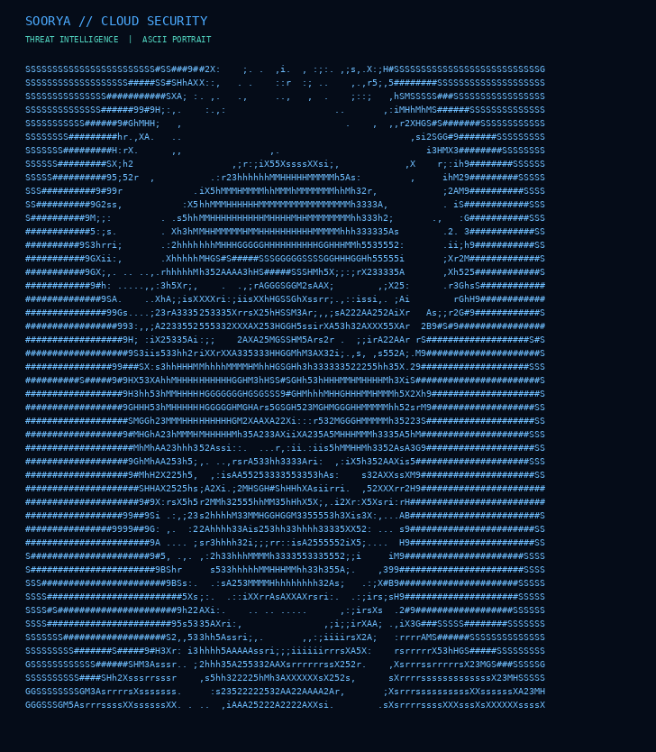

# Soorya | ASCII Portrait

### Turning Pixels Into Code.

A personal creative coding project that transforms photographs into ASCII art using Python and image processing.

<p align="center">
  
</p>

## About This Project

This project explores the combination of programming, digital art and image processing by converting a photograph into a text-based ASCII portrait.

Built as a personal coding experiment with a cybersecurity-inspired visual identity.

## Project Files

| File | Description |
|---|---|
| `soorya_ascii_portrait_preview.png` | Portrait preview |
| `soorya_ascii_portrait.txt` | ASCII artwork |
| `ascii_portrait.py` | Python image converter |
| `requirements.txt` | Project dependencies |

## Downloads

- [Download Portrait (PNG)](soorya_ascii_portrait_preview.png)
- [View ASCII Artwork (TXT)](soorya_ascii_portrait.txt)
- [Explore Python Source Code](ascii_portrait.py)

## How to Generate Your Own

1. Install Python 3.
2. Download or clone this repository.
3. Install the dependencies:

```bash
pip install -r requirements.txt
```

4. Run the generator:

```bash
